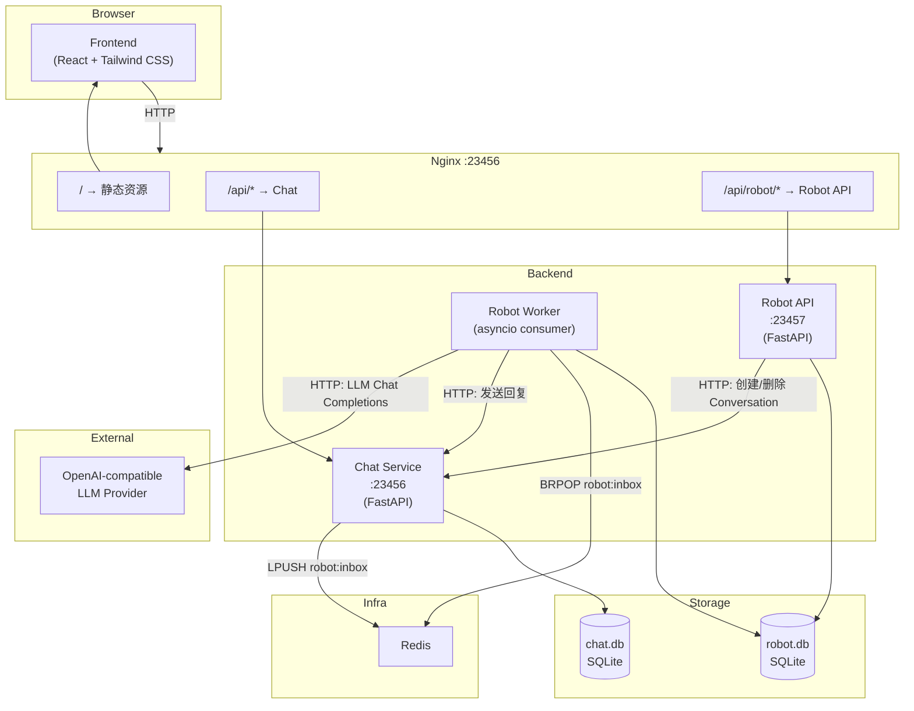
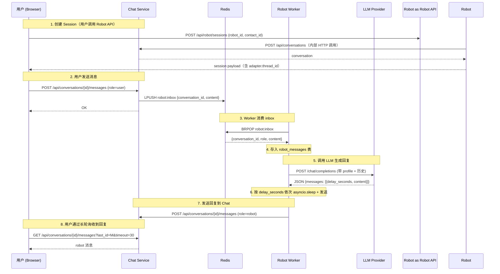
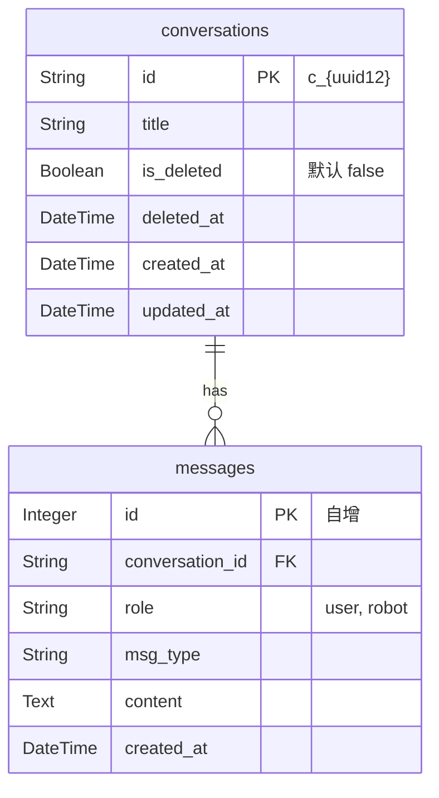
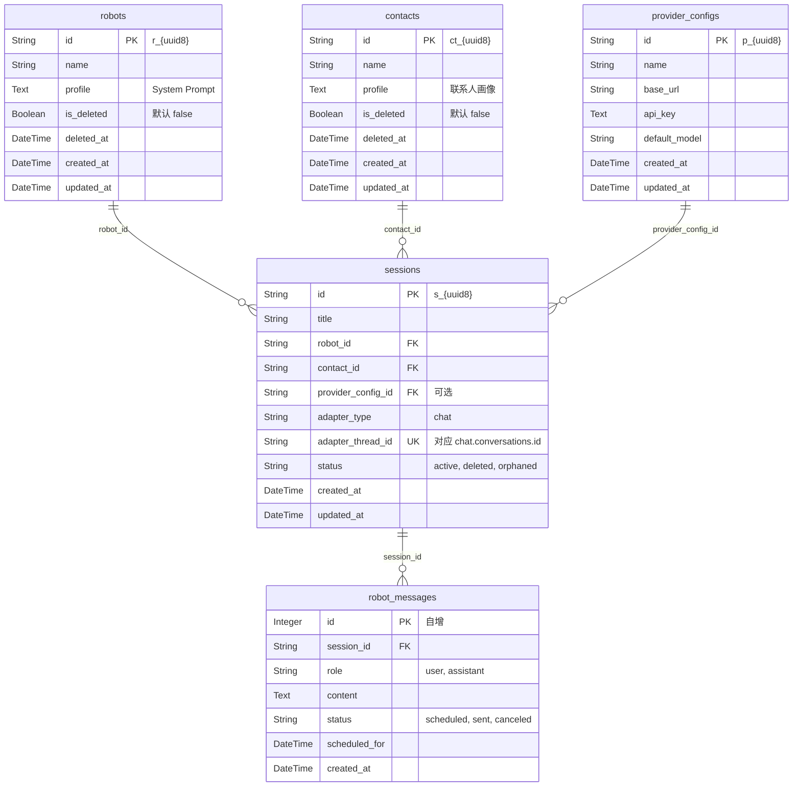

# Laborster

Laborster 是一个面向私聊场景的 **AI 角色调试工作台**。通过前后端分离架构，将「聊天数据」与「角色策略/编排」拆分为两个独立后端，实现清晰的领域边界与灵活的消息流控制。

---

## 架构概览



---

## 消息流



---

## 核心概念

| 概念 | 归属 | 说明 |
| --- | --- | --- |
| `Robot` | robot.db | 机器人角色模板，含 `name` + `profile`(System Prompt) |
| `Contact` | robot.db | 独立联系人画像实体，含 `name` + `profile` |
| `ProviderConfig` | robot.db | LLM Provider 配置：`base_url` / `api_key` / `default_model` |
| `Session` | robot.db | 核心会话资源，关联 Robot + Contact + adapter thread |
| `RobotMessage` | robot.db | Robot 拥有的完整消息历史（source of truth） |
| `Conversation` | chat.db | 纯聊天会话，不关心角色/策略 |
| `Message` | chat.db | 聊天消息，区分 `user` / `robot` |

---

## 数据库结构

### chat.db



### robot.db



---

## 组件职责

| 组件 | 路径 | 职责 |
| --- | --- | --- |
| **Chat** | `chat/` | 会话 CRUD、消息写入与长轮询、用户消息推送到 Redis inbox |
| **Robot API** | `robot/main.py` | Robot / Contact / Session / ProviderConfig API |
| **Robot Worker** | `robot/worker.py` + `robot/runtime.py` | 单消费者 loop：BRPOP inbox → 存消息 → 调 LLM → 延迟发送回复 |
| **Frontend** | `frontend/` | React SPA (Vite + React + Tailwind CSS)，Nginx 容器内构建并托管 |
| **Storage** | `storage/` | `chat.db`、`robot.db` 等运行时数据 |

---

## API 参考

Nginx 对外暴露两个后端命名空间：

- `/api/*` → Chat 服务
- `/api/robot/*` → Robot API 服务

### Chat API

| 方法 | 路径 | 说明 |
| --- | --- | --- |
| POST | `/api/conversations` | 创建会话 |
| GET | `/api/conversations` | 列出会话 (`?include_deleted=true`) |
| GET | `/api/conversations/{id}` | 获取单个会话 |
| PUT | `/api/conversations/{id}` | 更新会话标题 |
| DELETE | `/api/conversations/{id}` | 软删除会话 |
| POST | `/api/conversations/{id}/restore` | 恢复已删除会话 |
| POST | `/api/conversations/{id}/messages` | 写入消息 (`role=user\|robot`)，user 消息自动推送到 Redis |
| GET | `/api/conversations/{id}/messages` | 获取消息 (`?last_id=&timeout=` 支持长轮询) |

### Robot API

| 方法 | 路径 | 说明 |
| --- | --- | --- |
| POST | `/api/robot/robots` | 创建 Robot |
| GET | `/api/robot/robots` | 列出 Robots (`?include_deleted=true`) |
| PUT | `/api/robot/robots/{id}` | 更新 Robot |
| DELETE | `/api/robot/robots/{id}` | 软删除 Robot |
| POST | `/api/robot/robots/{id}/restore` | 恢复 Robot |
| POST | `/api/robot/contacts` | 创建联系人 |
| GET | `/api/robot/contacts` | 列出联系人 (`?include_deleted=true`) |
| PUT | `/api/robot/contacts/{id}` | 更新联系人 |
| DELETE | `/api/robot/contacts/{id}` | 软删除联系人 |
| POST | `/api/robot/contacts/{id}/restore` | 恢复联系人 |
| POST | `/api/robot/provider-configs` | 创建 ProviderConfig |
| GET | `/api/robot/provider-configs` | 列出 ProviderConfig |
| PUT | `/api/robot/provider-configs/{id}` | 更新 ProviderConfig |
| DELETE | `/api/robot/provider-configs/{id}` | 删除 ProviderConfig |
| POST | `/api/robot/sessions` | 创建 Session (自动创建 Conversation) |
| GET | `/api/robot/sessions` | 列出 Sessions (`?include_deleted=true`) |
| GET | `/api/robot/sessions/{id}` | 获取 Session 详情 |
| PUT | `/api/robot/sessions/{id}` | 更新 Session (标题/Robot/Contact) |
| DELETE | `/api/robot/sessions/{id}` | 软删除 Session + 底层 Conversation |
| POST | `/api/robot/sessions/{id}/restore` | 恢复 Session + 底层 Conversation |

---

## 目录结构

```text
.
├── chat/
│   ├── __init__.py
│   ├── main.py              # Chat 后端入口 (FastAPI app + 路由 + Redis 推送)
│   ├── models.py            # SQLAlchemy ORM 模型 (Conversation, Message)
│   ├── schemas.py           # Pydantic 请求模型
│   └── db.py                # 数据库引擎与工具函数
├── robot/
│   ├── __init__.py
│   ├── main.py               # Robot API (FastAPI)
│   ├── worker.py              # Worker 启动入口
│   ├── runtime.py             # Worker 核心消费者 loop
│   ├── models.py              # SQLAlchemy ORM 模型
│   ├── schemas.py             # Pydantic 请求模型
│   ├── clients.py             # Chat API / Provider HTTP 客户端
│   └── db.py                  # 数据库引擎与工具函数
├── frontend/
│   ├── Dockerfile             # 多阶段构建 (Node build → Nginx)
│   ├── index.html             # Vite 入口 HTML
│   ├── package.json           # Node 依赖
│   ├── vite.config.ts         # Vite 配置
│   ├── tsconfig.json          # TypeScript 配置
│   └── src/
│       ├── main.tsx           # React 应用入口
│       ├── App.tsx            # 根组件 (Layout + Modal 管理)
│       ├── index.css          # Tailwind CSS 入口 + 自定义样式
│       ├── hooks/
│       │   └── useAppStore.ts # 全局状态 Hook
│       ├── lib/
│       │   ├── api.ts         # 后端 API 封装 (fetch)
│       │   ├── utils.ts       # 工具函数
│       │   └── templates.ts   # 模板常量
│       └── components/
│           ├── Icons.tsx              # SVG 图标组件
│           ├── Modal.tsx              # 通用 Modal 组件
│           ├── Sidebar.tsx            # 侧边栏 (Robot/Session 列表)
│           ├── ChatArea.tsx           # 聊天区域 (消息 + 输入)
│           ├── CreateRobotModal.tsx   # 创建 Robot 弹窗
│           ├── EditRobotModal.tsx     # 编辑 Robot 弹窗
│           ├── CreateContactModal.tsx # 创建联系人弹窗
│           ├── EditContactModal.tsx   # 编辑联系人弹窗
│           ├── CreateSessionModal.tsx # 创建 Session 弹窗
│           ├── EditSessionModal.tsx   # 编辑 Session 弹窗
│           └── SettingsModal.tsx      # 设置弹窗 (Robot/联系人/Provider)
├── docker-compose.yml
├── Dockerfile
├── nginx.conf
├── pyproject.toml
└── README.md
```

---

## 快速开始

### Docker Compose 启动

```bash
docker compose up --build
```

访问地址：`http://localhost:23456`

Compose 启动五个服务：

| 服务 | 说明 |
| --- | --- |
| `nginx` | 统一入口，托管前端并分发 API 请求 |
| `redis` | 消息队列 (inbox) |
| `chat` | 聊天后端 |
| `robot-api` | Robot 领域 API |
| `robot-worker` | 后台 Worker (消费 inbox → LLM 生成 → 延迟发送) |

### 初始化 Provider Config

系统启动后，需要通过 API 或前端设置页创建一个 Provider Config，否则 Robot Worker 无法调用 LLM：

```bash
curl -X POST http://localhost:23456/api/robot/provider-configs \
  -H 'Content-Type: application/json' \
  -d '{
    "name": "deepseek",
    "base_url": "https://api.deepseek.com",
    "api_key": "YOUR_API_KEY",
    "default_model": "deepseek-chat"
  }'
```

> `base_url` 是 `/chat/completions` 之前的前缀。
> 例：DeepSeek → `https://api.deepseek.com`，OpenAI → `https://api.openai.com/v1`

### 本地直接运行

```bash
# 启动 Redis
redis-server

# 聊天后端
REDIS_URL=redis://localhost:6379/0 uv run uvicorn chat.main:app --host 0.0.0.0 --port 23456

# Robot API
uv run python -m robot.main --host 127.0.0.1 --port 23457 --chat-api-base-url http://127.0.0.1:23456/api

# Robot Worker
uv run python -m robot.worker --chat-api-base-url http://127.0.0.1:23456/api --redis-url redis://localhost:6379/0 --request-timeout 120

# 复读模式 (不需要 LLM)
uv run python -m robot.worker --chat-api-base-url http://127.0.0.1:23456/api --redis-url redis://localhost:6379/0 --request-timeout 120 --echo-mode
```

### 前端开发模式

```bash
cd frontend
npm install
npm run dev
```

前端开发服务器默认运行在 `http://localhost:5173`，已配置 Vite 代理将 `/api` 和 `/storage` 请求转发到 `http://localhost:23456`（需要后端服务同时运行）。

---

## 启动参数

### Robot API

| 参数 | 说明 | 默认值 |
| --- | --- | --- |
| `--host` | 监听地址 | 必填 |
| `--port` | 监听端口 | 必填 |
| `--chat-api-base-url` | Chat API 地址 | 必填 |

### Chat Service

| 环境变量 | 说明 | 默认值 |
| --- | --- | --- |
| `REDIS_URL` | Redis 连接地址 | 必填，未设置报错 |

### Robot Worker

| 参数 | 说明 | 默认值 |
| --- | --- | --- |
| `--chat-api-base-url` | Chat API 地址 | 必填 |
| `--redis-url` | Redis 连接地址 | 必填 |
| `--request-timeout` | LLM 请求超时 (秒) | 必填 |
| `--echo-mode` | 复读模式 (不调用 LLM) | 关闭 |

---

## 持久化

Docker Compose 创建名为 `app-storage` 的 volume，保存：

- `storage/chat.db` — 聊天数据
- `storage/robot.db` — Robot 领域数据

容器重建后数据保留。

---

## 设计备注

### 架构原则

- **消息队列 + 消费者模型**：Chat 写入消息后 LPUSH 到 Redis inbox，Worker BRPOP 消费
- **Robot 拥有完整消息历史**：`robot_messages` 表是 source of truth，Worker 不依赖 Adapter 在线
- **无流水表**：Worker 处理过程纯内存，可靠性靠 DB 兜底（重启后扫描未回复的 session 恢复）
- **延迟发送用 asyncio.sleep**：不需要额外表或定时器
- **新消息取消旧任务**：用户发新消息时，Worker 取消该 session 正在进行的处理任务，重新生成

### 已知约束

- `chat` 不关心 Robot / Contact / Session / ProviderConfig
- `robot-api` 只做 API，不消费后台任务
- `robot-worker` 通过 Redis 感知新消息，通过 Chat HTTP API 发送回复
- 两个 SQLite 数据库之间没有跨库外键约束
- 无认证/授权机制 (调试用途)
