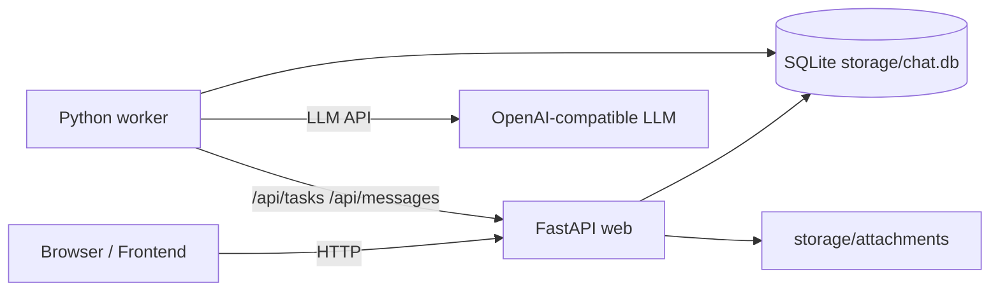

# Laborster

Laborster 是一个面向私聊场景的 **AI 角色调试工作台**：你可以为不同 Robot 配置 system prompt，为不同会话配置 user profile，然后通过前端观察用户消息、任务调度、计划回复和最终落库消息的完整链路。

它的目标不是做一个通用聊天产品，而是让 **角色设定、粉丝画像、延迟回复策略和 Worker 调度** 能在一个最小可运行系统里被快速验证。

## 核心能力

- **Robot 人设管理**：创建和编辑机器人名称、system prompt
- **会话级粉丝档案**：为每个会话维护独立 user profile
- **异步任务处理**：用户发送消息后生成 Task，由 worker 轮询处理
- **计划回复机制**：LLM 可返回多条带延迟的消息，worker 按时间写入 planned replies 并逐条发送
- **单容器前端托管**：FastAPI 同时提供 API 和静态前端页面
- **Docker Compose 启动**：`web + worker + volume` 一次启动

## 项目背景

这个项目围绕一个很具体的调试模型展开：

1. **Robot** 表示一个可复用的人设模板，核心是 `system_prompt`
2. **Conversation** 表示某个具体对象的一条聊天线，核心是 `user_profile`
3. 用户消息写入数据库后，会触发一条 **Task**
4. **Worker** 拉取待处理任务，拼装上下文并请求 LLM
5. LLM 返回结构化 JSON，生成一组 **PlannedReply**
6. Worker 到点把 PlannedReply 逐条发送成真实消息

这让你可以同时调试：

- prompt 设计是否稳定
- 用户画像是否影响回复
- 延迟发送节奏是否符合预期
- 中断、重试和轮询链路是否正常

## 架构概览

### 运行时架构



### 组件职责

| 组件 | 位置 | 职责 |
| --- | --- | --- |
| Web | `app/main.py` | FastAPI API、SQLite ORM、静态前端托管 |
| Frontend | `frontend/` | Vue 3 + CDN Tailwind 单页调试界面 |
| Worker | `worker/main.py` | 轮询任务、调用 LLM、生成和发送计划回复 |
| Storage | `storage/` | SQLite 数据库和附件文件 |

### 数据流

1. 前端调用 `POST /api/messages` 写入用户消息
2. 后端为该会话创建 `tasks` 记录，并清理未发送的计划回复
3. worker 轮询 `GET /api/tasks?status=pending`
4. worker 读取 `/api/conversations/{id}/messages` 组装上下文
5. worker 调用 LLM，解析 JSON，写入 `/api/planned_replies`
6. worker 轮询到期 planned replies，转成真实 robot 消息
7. 前端通过长轮询和短轮询分别看到新消息与计划回复

## 目录结构

```text
.
├── app/                 # FastAPI 服务与数据库模型
├── frontend/            # 静态前端（Vue 3 + Tailwind CDN）
├── worker/              # 异步 worker 与 LLM 调用逻辑
├── storage/             # SQLite / 附件（运行时生成）
├── Dockerfile
├── docker-compose.yml
├── pyproject.toml
└── .github/
    └── copilot-instructions.md
```

## Docker Compose 启动

项目包含两个常驻进程：

- `web`：FastAPI 服务，负责 API、SQLite、附件和前端页面
- `worker`：轮询任务并调用 LLM 生成回复

前端由 `web` 直接托管，所以不需要独立前端容器。

### 1. 准备环境变量

```bash
cp .env.example .env
```

至少需要配置：

- `LLM_API_KEY`
- 如果你使用非默认兼容接口，再调整 `LLM_BASE_URL` 和 `LLM_MODEL`

如果只是联调整体链路，可以把：

```bash
ECHO_MODE=true
```

这样 worker 会进入复读模式，不依赖真实 LLM。

### 2. 启动

```bash
docker compose up --build
```

默认访问地址：

```text
http://localhost:23456
```

如果想改宿主机端口，可以在 `.env` 里调整 `WEB_PORT`。

### 3. 持久化数据

Compose 会创建名为 `app-storage` 的 volume，用来保存：

- `storage/chat.db`
- `storage/attachments/`

即使容器重建，这些数据也会继续保留。

## 开发说明

### 本地直接运行

```bash
uv run uvicorn app.main:app --host 0.0.0.0 --port 23456
uv run python worker/main.py
```

### 关键环境变量

| 变量 | 说明 | 默认值 |
| --- | --- | --- |
| `WEB_PORT` | Web 对宿主机暴露端口 | `23456` |
| `LLM_BASE_URL` | OpenAI 兼容接口地址 | `https://api.deepseek.com` |
| `LLM_API_KEY` | LLM API Key | 空 |
| `LLM_MODEL` | 使用的模型名 | `deepseek-chat` |
| `REQUEST_TIMEOUT` | LLM 请求超时（秒） | `120` |
| `POLL_INTERVAL` | Worker 拉取任务间隔（秒） | `2` |
| `MAX_RETRIES` | Task 最大重试次数 | `3` |
| `ECHO_MODE` | 是否启用复读模式 | `false` |

## 代码层面的几个关键约束

- **FastAPI 同时托管 API 和静态前端**，不要默认把前端当成独立 Node 项目
- **worker 是独立 Python 进程**，与 web 通过 `/api` 通信
- **SQLite 位于 `storage/chat.db`**，容器部署时必须保留持久化
- **planned replies 以 UTC naive datetime 存储**，处理时间逻辑时不要随意改格式
- 前端目前没有构建流程，直接使用 **Vue 3 全局版 + Tailwind CDN**

## 适合继续扩展的方向

- 增加 Robot 模板库和 prompt 版本管理
- 增加会话标签、打赏分层和更多画像字段
- 支持多种 LLM provider 和回放日志
- 为 Task / PlannedReply 增加管理后台和诊断信息
