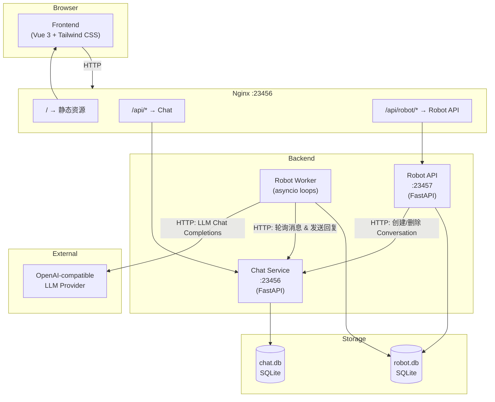
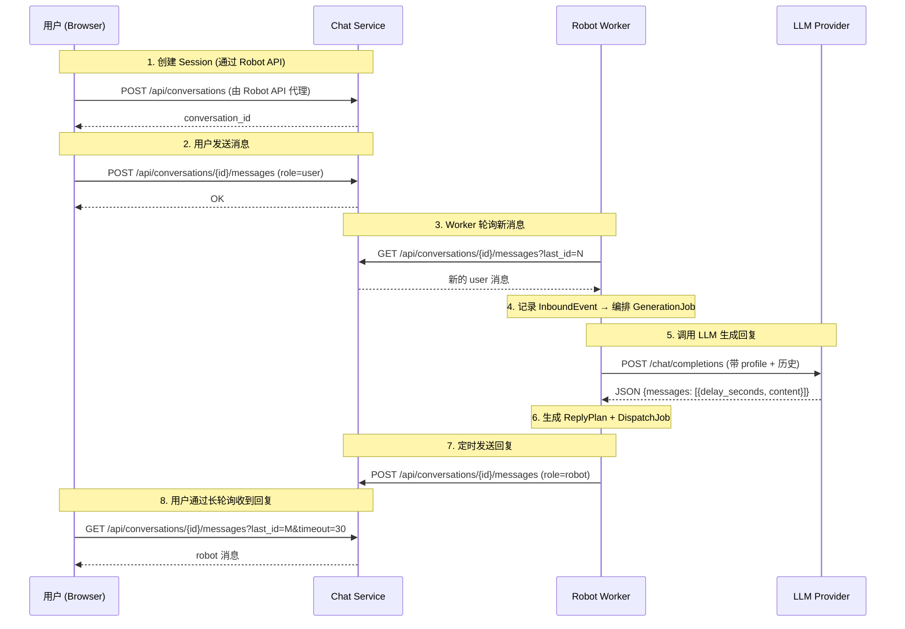
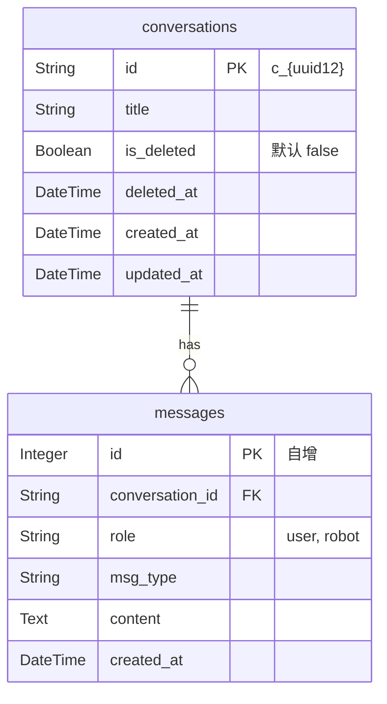

# Laborster

Laborster 是一个面向私聊场景的 **AI 角色调试工作台**。通过前后端分离架构，将「聊天数据」与「角色策略/编排」拆分为两个独立后端，实现清晰的领域边界与灵活的消息流控制。

---

## 架构概览



---

## 消息流



---

## 核心概念

| 概念 | 归属 | 说明 |
| --- | --- | --- |
| `Robot` | robot.db | 机器人角色模板，含 `name` + `profile`(System Prompt) |
| `Contact` | robot.db | 独立联系人画像实体，含 `name` + `profile` |
| `ProviderConfig` | robot.db | LLM Provider 配置：`base_url` / `api_key` / `default_model` |
| `Session` | robot.db | 核心会话资源，关联 Robot + Contact + adapter thread |
| `InboundEvent` | robot.db | 从 adapter (Chat) 摄入的入站用户消息事件 |
| `GenerationJob` | robot.db | 基于入站事件生成回复的异步任务 |
| `ReplyPlan` | robot.db | LLM 生成的计划回复（含延迟调度时间） |
| `DispatchJob` | robot.db | 把 ReplyPlan 发回 adapter 的发送任务 |
| `Conversation` | chat.db | 纯聊天会话，不关心角色/策略 |
| `Message` | chat.db | 聊天消息，区分 `user` / `robot` |

---

## 数据库结构

### chat.db



### robot.db

```mermaid
erDiagram
    robots {
        String id PK "r_{uuid8}"
        String name
        Text profile "System Prompt"
        Boolean is_deleted "默认 false"
        DateTime deleted_at
        DateTime created_at
        DateTime updated_at
    }

    contacts {
        String id PK "ct_{uuid8}"
        String name
        Text profile "联系人画像"
        Boolean is_deleted "默认 false"
        DateTime deleted_at
        DateTime created_at
        DateTime updated_at
    }

    provider_configs {
        String id PK "p_{uuid8}"
        String name
        String base_url
        Text api_key
        String default_model
        DateTime created_at
        DateTime updated_at
    }

    sessions {
        String id PK "s_{uuid8}"
        String title
        String robot_id FK
        String contact_id FK
        String provider_config_id FK "可选，指定使用哪个 LLM Provider"
        String adapter_type "chat"
        String adapter_thread_id UK "对应 chat.conversations.id"
        String status "active, deleted, orphaned"
        Integer last_ingested_message_id
        DateTime created_at
        DateTime updated_at
    }

    inbound_events {
        Integer id PK "自增"
        String session_id FK
        Integer adapter_message_id "UQ(session_id, adapter_message_id)"
        String role
        Text content
        String status "pending, processed, failed"
        DateTime created_at
        DateTime processed_at
    }

    generation_jobs {
        Integer id PK "自增"
        String session_id FK
        Integer trigger_event_id FK
        String provider_config_id FK
        String provider_name
        String provider_base_url
        String selected_model
        String status "pending, running, completed, canceled, failed"
        Text error
        DateTime created_at
        DateTime started_at
        DateTime finished_at
    }

    reply_plans {
        Integer id PK "自增"
        String session_id FK
        Integer generation_job_id FK
        Text content
        DateTime scheduled_for
        String status "pending, sent, canceled, failed"
        DateTime created_at
        DateTime updated_at
        DateTime sent_at
        DateTime canceled_at
        Text failure_reason
    }

    dispatch_jobs {
        Integer id PK "自增"
        String session_id FK
        Integer reply_plan_id FK_UK
        DateTime scheduled_for
        String status "pending, running, completed, canceled, failed"
        Text error
        DateTime created_at
        DateTime started_at
        DateTime finished_at
    }

    robots ||--o{ sessions : "robot_id"
    contacts ||--o{ sessions : "contact_id"
    provider_configs ||--o{ sessions : "provider_config_id"
    sessions ||--o{ inbound_events : "session_id"
    sessions ||--o{ generation_jobs : "session_id"
    sessions ||--o{ reply_plans : "session_id"
    sessions ||--o{ dispatch_jobs : "session_id"
    inbound_events ||--o{ generation_jobs : "trigger_event_id"
    generation_jobs ||--o{ reply_plans : "generation_job_id"
    reply_plans ||--|| dispatch_jobs : "reply_plan_id"
```

---

## 组件职责

| 组件 | 路径 | 职责 |
| --- | --- | --- |
| **Chat** | `chat/main.py` | 会话 CRUD、消息写入与长轮询、聊天数据持久化 |
| **Robot API** | `robot/main.py` | Robot / Contact / Session / ProviderConfig API，Session 创建时代理调用 Chat 创建会话 |
| **Robot Worker** | `robot/worker.py` + `robot/runtime.py` | 4 个 asyncio 循环：ingest → orchestrate → generate → dispatch |
| **Frontend** | `frontend/` | 静态 SPA (Vue 3 + Tailwind CSS)，由 Nginx 直接托管 |
| **Storage** | `storage/` | `chat.db`、`robot.db`、`attachments/` 等运行时数据 |

### Robot Worker 内部循环

| 循环 | 作用 |
| --- | --- |
| `ingest_loop` | 按 Session 轮询 Chat 消息接口，将新 user 消息写入 `inbound_events` |
| `orchestrator_loop` | 为 pending 的 InboundEvent 创建 `generation_jobs`，绑定当前唯一的 ProviderConfig |
| `generation_loop` | 取出 pending 的 GenerationJob，调用 LLM，将结果写入 `reply_plans` + `dispatch_jobs` |
| `dispatch_loop` | 按 `scheduled_for` 时间发送到期的 DispatchJob，调用 Chat 写入 robot 消息 |

---

## API 参考

Nginx 对外暴露两个后端命名空间：

- `/api/*` → Chat 服务
- `/api/robot/*` → Robot API 服务

### Chat API

| 方法 | 路径 | 说明 |
| --- | --- | --- |
| POST | `/api/conversations` | 创建会话 |
| GET | `/api/conversations` | 列出会话 (`?include_deleted=true`) |
| GET | `/api/conversations/{id}` | 获取单个会话 |
| PUT | `/api/conversations/{id}` | 更新会话标题 |
| DELETE | `/api/conversations/{id}` | 软删除会话 |
| POST | `/api/conversations/{id}/restore` | 恢复已删除会话 |
| POST | `/api/conversations/{id}/messages` | 写入消息 (`role=user\|robot`) |
| GET | `/api/conversations/{id}/messages` | 获取消息 (`?last_id=&timeout=` 支持长轮询) |

### Robot API

| 方法 | 路径 | 说明 |
| --- | --- | --- |
| POST | `/api/robot/robots` | 创建 Robot |
| GET | `/api/robot/robots` | 列出 Robots (`?include_deleted=true`) |
| PUT | `/api/robot/robots/{id}` | 更新 Robot |
| DELETE | `/api/robot/robots/{id}` | 软删除 Robot |
| POST | `/api/robot/robots/{id}/restore` | 恢复 Robot |
| POST | `/api/robot/contacts` | 创建联系人 |
| GET | `/api/robot/contacts` | 列出联系人 (`?include_deleted=true`) |
| PUT | `/api/robot/contacts/{id}` | 更新联系人 |
| DELETE | `/api/robot/contacts/{id}` | 软删除联系人 |
| POST | `/api/robot/contacts/{id}/restore` | 恢复联系人 |
| POST | `/api/robot/provider-configs` | 创建 ProviderConfig (最多一个) |
| GET | `/api/robot/provider-configs` | 列出 ProviderConfig |
| PUT | `/api/robot/provider-configs/{id}` | 更新 ProviderConfig |
| DELETE | `/api/robot/provider-configs/{id}` | 删除 ProviderConfig |
| POST | `/api/robot/sessions` | 创建 Session (自动创建 Conversation) |
| GET | `/api/robot/sessions` | 列出 Sessions (`?include_deleted=true`) |
| GET | `/api/robot/sessions/{id}` | 获取 Session 详情(含 reply_plans) |
| PUT | `/api/robot/sessions/{id}` | 更新 Session (标题/Robot/Contact) |
| DELETE | `/api/robot/sessions/{id}` | 软删除 Session + 底层 Conversation |
| POST | `/api/robot/sessions/{id}/restore` | 恢复 Session + 底层 Conversation |
| GET | `/api/robot/sessions/{id}/reply-plans` | 获取 Session 的 ReplyPlan 列表 |

---

## 目录结构

```text
.
├── chat/
│   └── main.py              # Chat 后端 (会话 + 消息)
├── robot/
│   ├── __init__.py
│   ├── main.py               # Robot API (FastAPI)
│   ├── worker.py              # Worker 启动入口
│   ├── runtime.py             # Worker 核心 4 循环
│   ├── models.py              # SQLAlchemy ORM 模型
│   ├── schemas.py             # Pydantic 请求模型
│   ├── clients.py             # Chat API / Provider HTTP 客户端
│   └── db.py                  # 数据库引擎与工具函数
├── frontend/
│   ├── index.html             # SPA 入口
│   ├── css/style.css          # 样式
│   └── js/
│       ├── api.js             # API 封装层
│       ├── app.js             # Vue 3 应用逻辑
│       └── utils.js           # 工具函数
├── docker-compose.yml
├── Dockerfile
├── nginx.conf
├── pyproject.toml
└── README.md
```

---

## 快速开始

### Docker Compose 启动

```bash
docker compose up --build
```

访问地址：`http://localhost:23456`

Compose 启动四个服务：

| 服务 | 说明 |
| --- | --- |
| `nginx` | 统一入口，托管前端并分发 API 请求 |
| `chat` | 聊天后端 |
| `robot-api` | Robot 领域 API |
| `robot-worker` | 后台 Worker (消息摄入 → LLM 生成 → 定时发送) |

### 初始化 Provider Config

系统启动后，需要通过 API 或前端设置页创建一个 Provider Config，否则 Robot Worker 无法调用 LLM：

```bash
curl -X POST http://localhost:23456/api/robot/provider-configs \
  -H 'Content-Type: application/json' \
  -d '{
    "name": "deepseek",
    "base_url": "https://api.deepseek.com",
    "api_key": "YOUR_API_KEY",
    "default_model": "deepseek-chat"
  }'
```

> `base_url` 是 `/chat/completions` 之前的前缀。
> 例：DeepSeek → `https://api.deepseek.com`，OpenAI → `https://api.openai.com/v1`

当前实现要求系统中只存在一个 Provider Config。如果有多个，Worker 会报错。

### 本地直接运行

```bash
# 聊天后端
uv run uvicorn chat.main:app --host 0.0.0.0 --port 23456

# Robot API
uv run python -m robot.main --host 127.0.0.1 --port 23457 --chat-api-base-url http://127.0.0.1:23456/api

# Robot Worker
uv run python -m robot.worker --chat-api-base-url http://127.0.0.1:23456/api

# 复读模式 (不需要 LLM)
uv run python -m robot.worker --chat-api-base-url http://127.0.0.1:23456/api --echo-mode
```

---

## 启动参数

### Robot API

| 参数 | 说明 | 默认值 |
| --- | --- | --- |
| `--host` | 监听地址 | `127.0.0.1` |
| `--port` | 监听端口 | `23457` |
| `--chat-api-base-url` | Chat API 地址 | 必填 |

### Robot Worker

| 参数 | 说明 | 默认值 |
| --- | --- | --- |
| `--chat-api-base-url` | Chat API 地址 | 必填 |
| `--request-timeout` | LLM 请求超时 (秒) | `120` |
| `--poll-interval` | 轮询 Chat 间隔 (秒) | `2` |
| `--echo-mode` | 复读模式 (不调用 LLM) | 关闭 |

---

## 持久化

Docker Compose 创建名为 `app-storage` 的 volume，保存：

- `storage/chat.db` — 聊天数据
- `storage/robot.db` — Robot 领域数据
- `storage/attachments/` — 附件文件

容器重建后数据保留。

---

## 设计备注

### 已知约束

- `chat` 不关心 Robot / Contact / Session / ProviderConfig
- `robot-api` 只做 API，不消费后台任务
- `robot-worker` 通过 Chat HTTP API 感知新消息，不直接读写 `chat.db`
- ProviderConfig 当前只支持一个，或启用 `--echo-mode`
- 两个 SQLite 数据库之间没有跨库外键约束
- 无认证/授权机制 (调试用途)

### 已识别的设计改进方向

1. **chat 长轮询** — 当前使用 `asyncio.sleep(0.5)` 轮询，高并发场景可考虑替换为 WebSocket 或服务端事件推送
2. **Worker DB 会话管理** — 每个操作独立开关 DB Session，可考虑引入 context manager 减少样板代码
3. **LLM 历史截断** — 当前每次生成都传完整对话历史到 LLM，长会话需要截断或摘要策略
4. **重试机制** — Worker 对 LLM 调用没有重试，网络瞬断会直接 fail
5. **Worker 轮询间隔不一致** — `ingest_loop` / `orchestrator_loop` 使用 `poll_interval`，但 `generation_loop` / `dispatch_loop` 固定 1 秒
