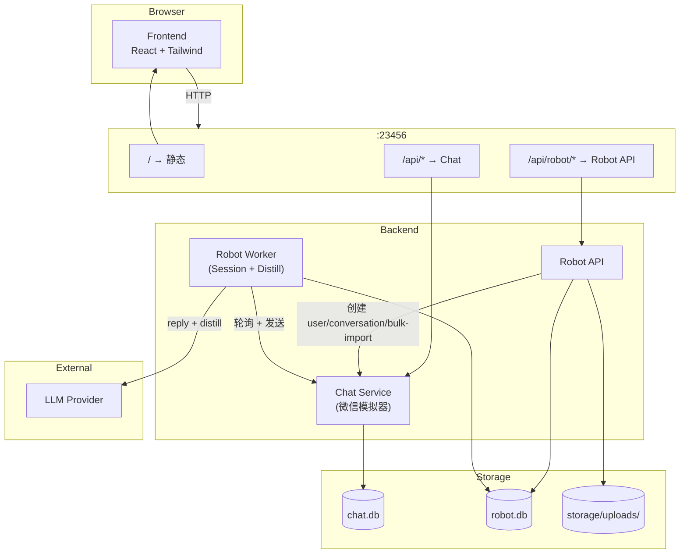

# Laborster

Laborster 是一个**通用拟人化私聊接管服务**：让 AI 替你的主播 / 销售 / 自由职业者，在长期私聊场景里自动回复联系人，保温关系。

> 当前阶段聚焦「主播-粉丝」场景，命名上保持中性（Operator / Contact）以兼容未来扩展。详细产品定位与规则参见 [AGENTS.md](./AGENTS.md)。

---

## 当前重构状态

仓库正在被拆分成两个**完全独立的项目**，目前共用一个 git 仓库只是为了管理方便：

- [`services/chat/`](services/chat/) — Chat 服务（独立项目）：自带 `api/pyproject.toml` + `uv.lock`、独立 Dockerfile、独立 `compose.yaml`、独立前端 `web/`，不依赖仓库根目录的任何文件。
- 根目录 + [`robot/`](robot/) + [`frontend/`](frontend/) — Robot 服务（待迁移）：长期目标也会被拆成独立项目，目前仍在根目录。

长期目标是 `平台(A) <-> 本地客户端(B) <-> Robot(C)`：微信 / 飞书 / QQ / Chat 都属于 A，未来新开发的主播电脑客户端 B 是唯一桥梁，Robot 不直接连真实平台。

### 启动 Chat 服务

Chat 是独立项目，从 `services/chat/` 起：

```bash
cd services/chat
CHAT_HTTP_PORT=23458 docker compose up -d --build

# 创建账号（首次）
CHAT_HTTP_PORT=23458 docker compose exec -T chat-api \
  uv run python -m chat.cli create-account \
  --username demo --password demo123 --display-name 演示账号
```

打开 http://localhost:23458 ，用 `demo / demo123` 登录。

本地不用 docker：

```bash
cd services/chat/api
CHAT_STORAGE_DIR=$PWD/.storage uv run uvicorn chat.main:app --host 0.0.0.0 --port 23456

# 另开终端启动 web
cd services/chat/web && npm install && npm run dev
```

### Chat 账号管理 CLI

```bash
cd services/chat/api
CHAT_STORAGE_DIR=$PWD/.storage uv run python -m chat.cli create-account \
  --username anchor --password secret123 --display-name 主播

CHAT_STORAGE_DIR=$PWD/.storage uv run python -m chat.cli list-accounts
CHAT_STORAGE_DIR=$PWD/.storage uv run python -m chat.cli reset-password --username anchor --password newpass
```

### 启动 Robot 服务

Robot 仍在仓库根目录，需要先有一个跑着的 Chat 服务。最简单的方式：先按上面把 Chat 起到 `host:23458`，再起 Robot：

```bash
CHAT_API_BASE_URL=http://host.docker.internal:23458/api docker compose up -d --build
```

打开 http://localhost:23456 看 Robot 控制台。

---

## 数据模型

三个核心原语：

| 原语 | 数量 | 角色 |
| --- | --- | --- |
| **Operator** | 1 / 账号 | 主播本人。包含 Persona（风格 + 生活情境） |
| **Contact** | N / Operator | 粉丝。包含 Card（备注名 / 关系档位 / 共享过的事实 等） |
| **Conversation** | 每个 Contact 一段 | 真实聊天历史，原始数据；蒸馏读它，运行时也读它 |

**Persona 和 Card 怎么来**：上传历史聊天 → 蒸馏（rolling fold over LLM）→ 自动生成 → 主播校对。运行时把 Persona + Card + 完整对话历史一起喂给 LLM，生成拟人回复。

---

## 架构



两个独立项目下的容器：

| 容器 | 所属项目 | 角色 |
| --- | --- | --- |
| `chat-web` (nginx) | services/chat | Chat 静态资源 + 反代到 chat-api |
| `chat-api` | services/chat | 通用聊天 Adapter，**充当微信模拟器**——上传历史聊天会自动注入此处，调试者可继续在 Chat UI 里扮演粉丝聊天 |
| `nginx` | 根目录 (Robot) | Robot 静态资源 + 反代到 robot-api |
| `robot-api` | 根目录 (Robot) | Robot 领域 API（Operator / Contact / Archive / Distill / Provider） |
| `robot-worker` | 根目录 (Robot) | 1 Session Scanner + 1 Distill Scanner + N Session Loop。所有耗时的事都在这里 |

---

## 主播 Onboarding 流程

```
1. 创建 Operator（自动绑一个 chat 模拟器 user）
2. 配置 Provider Config
3. 上传 WeFlow JSON 聊天记录（指明 self_wxid）
   ↓
   robot-api 一次性完成：
     - 解析 → 写 robot.db (Contact + Session + messages)
     - 给粉丝创建 chat 模拟器 user
     - 创建 chat 模拟器 conversation
     - bulk-import 历史聊天到 chat（保留原始 timestamp）
4. 触发蒸馏 Job
   ↓
   robot-worker 后台跑：
     - 每个 Contact 切 session/window
     - rolling fold 更新 operator.persona_md + contact.card_md
5. 主播在 RobotPage 校对 Persona / Cards
6. 在 Chat UI 切换到粉丝身份继续聊天 → Worker 自动回复
```

历史聊天和实时聊天**进同一张 messages 表**（用 `source` 字段区分），蒸馏和运行时都能看到全量上下文。

---

## 数据库

### chat.db

| 表 | 说明 |
| --- | --- |
| `users` | chat 用户（Operator 和 Contact 都在这里有对应 shadow user） |
| `conversations` | chat 会话 |
| `messages` | chat 消息（包括 ingest 时 bulk-import 的历史） |

### robot.db

| 表 | 说明 |
| --- | --- |
| `provider_configs` | LLM Provider |
| `operators` | 主播本人。`adapter_identities` JSON 存各 adapter 上的身份 |
| `contacts` | 粉丝。`(operator_id, wechat_wxid)` 唯一 |
| `sessions` | 纯连接器：Contact ↔ adapter_thread_id |
| `chat_archives` | 上传的 WeFlow 文件清单（保留原始文件路径，便于重蒸） |
| `messages` | 统一消息表（upload + live） |
| `distill_jobs` | 蒸馏任务（pending/running/done/failed + progress JSON） |
| `llm_logs` | LLM 调用日志（reply / distill 共用） |

---

## API 速览

### Chat (`/api/*`)

| 方法 | 路径 | 说明 |
| --- | --- | --- |
| POST | `/users` | 创建 user |
| GET/PUT/DELETE | `/users/{id}` | 用户 CRUD |
| POST | `/conversations` | 创建会话 |
| GET | `/conversations/{id}/messages?last_id=&timeout=` | 长轮询拉消息 |
| POST | `/conversations/{id}/messages` | 发消息 |
| **POST** | **`/conversations/{id}/messages/bulk`** | **bulk import（保留历史 timestamp）** |

### Robot (`/api/robot/*`)

| 方法 | 路径 | 说明 |
| --- | --- | --- |
| GET/POST | `/provider-configs` | Provider CRUD |
| GET/POST | `/operators` | Operator CRUD（POST 自动建 chat user） |
| GET/PUT | `/operators/{id}` | 单个 Operator（PUT 改 persona_md / provider 等） |
| GET | `/operators/{id}/contacts` | 列出该 Operator 的粉丝 |
| PUT | `/contacts/{id}` | 改备注名 / Card |
| GET/POST | `/operators/{id}/chat-archives` | multipart 上传 + 列表 |
| GET/POST | `/operators/{id}/distill-jobs` | 触发蒸馏 + 列表 |
| GET | `/distill-jobs/{id}` | 查蒸馏进度 |
| GET | `/operators/{id}/sessions` | 看 Session 列表（read-only） |
| GET | `/sessions/{id}/planned-replies?last_count=&timeout=` | 长轮询查待发消息 |

---

## 快速开始

### 1. 起 Chat（独立项目，先起）

```bash
cd services/chat
CHAT_HTTP_PORT=23458 docker compose up -d --build
CHAT_HTTP_PORT=23458 docker compose exec -T chat-api \
  uv run python -m chat.cli create-account \
  --username demo --password demo123 --display-name 演示账号
```

Chat Lab 在 http://localhost:23458 。

### 2. 起 Robot（仍在仓库根目录）

```bash
CHAT_API_BASE_URL=http://host.docker.internal:23458/api docker compose up -d --build
```

Robot 控制台在 http://localhost:23456 。`storage/` 目录持久化 robot.db 和上传的 archive。

### 第一次使用

1. 进 RobotPage → Provider tab → 新建 Provider Config（base_url + api_key + model）
2. 顶部「新建主播」→ 填名字、选 Provider
3. 切到「聊天记录」tab → 填 self_wxid（在导出文件里要存在）→ 选文件 → 上传
4. 切到「蒸馏」tab → 「开始蒸馏」→ 等几分钟（可看进度）
5. 切到「人设」tab → 校对自动生成的人设
6. 切到「联系人」tab → 校对每个粉丝的 Card
7. 切到 ChatPage → 选刚自动创建的会话 → 切换为粉丝身份发消息 → 等 Worker 回复

### 启动参数

| 服务 | 必填参数 |
| --- | --- |
| `chat-api` | 环境变量 `CHAT_STORAGE_DIR`（监听 `0.0.0.0:23456`） |
| `robot-api` | `--host`, `--port`, `--chat-api-base-url` |
| `robot-worker` | `--chat-api-base-url`, `--request-timeout` |

### 本地开发（不用 docker）

```bash
# Chat (在 services/chat/api/ 下，独立项目)
cd services/chat/api
CHAT_STORAGE_DIR=$PWD/.storage uv run uvicorn chat.main:app --host 0.0.0.0 --port 23456

# Chat 前端（另开终端）
cd services/chat/web && npm install && npm run dev

# Robot API（仓库根目录）
uv run python -m robot.main \
  --host 127.0.0.1 --port 23457 \
  --chat-api-base-url http://127.0.0.1:23456/api

# Robot Worker
uv run python -m robot.worker \
  --chat-api-base-url http://127.0.0.1:23456/api \
  --request-timeout 120

# Robot 前端
cd frontend && npm install && npm run dev
```

蒸馏也可以脱离 worker 直接跑（调试用）：

```bash
uv run python -m robot.distill.pipeline \
  --operator-id op_xxxxxxxx --request-timeout 120
```

---

## 持久化

两个项目各自有独立的 storage：

- **Chat**：`services/chat/` 部署起来后，`chat-storage` docker volume（compose 里定义），里面是 `chat.db` + 附件。
- **Robot**：仓库根目录 `storage/`（docker bind-mount），里面是 `robot.db` + `uploads/{operator_id}/{archive_id}.json`（上传的 WeFlow 原始文件，保留以便未来 prompt 改动后重蒸）。

---

## 设计备注

- **「微信模拟器」是关键设计**：上传聊天记录时，**双写**到 robot.db（蒸馏用）和 chat.db（调试用），调试场景和真实微信场景代码路径完全同构。未来接微信只是换一个 Adapter，业务逻辑零改动。
- **三原语严格分离**：Operator 的人设和 Contact 的卡片是不同生命周期的资产，不要把它们塞进 Session。Session 只是 (Contact × adapter thread) 的连接器。
- **故障恢复天然**：Worker 重启后扫 active sessions 重建即可，无需任务表。Session Loop 启动取当前 `last_id` 自然跳过 backlog（包括 ingest bulk-import 的历史）。
- **蒸馏的产出是非对称的**：一份 Operator Persona 全 Operator 共享，N 份 Contact Card 各属各的粉丝。fold prompt（[robot/distill/prompts/fold.md](robot/distill/prompts/fold.md)）按这个形态写。
- **目前未实现 / 未来再做**：search-tool（基于 corpus 的事实召回）、Playbook（按场景定制 SYSTEM_INSTRUCTION）、增量蒸馏、多 adapter（真实微信 / 企微 / 飞书）。
